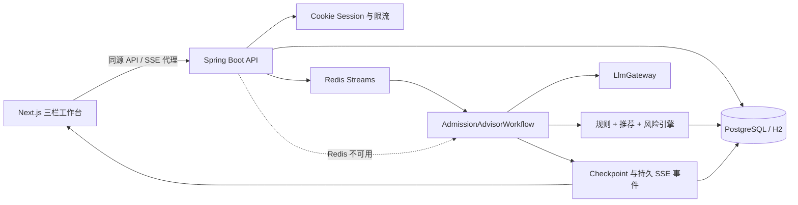

# 问津智愿 AI

问津智愿 AI 是一个面向高考生与家长的志愿咨询 MVP。它不是单纯的大模型聊天界面：候选院校和专业来自结构化招生数据库，Java 规则引擎负责硬性资格、预算和数据边界校验，推荐引擎负责冲稳保分层，风险引擎检查整张方案，大模型只承担意图理解和通俗解释。模型不可用时，系统会保留确定性结果并标记解释服务降级。

本项目没有使用第三方人物姓名、肖像、声音或品牌形象，也不代表任何考试院或高校官方产品。

## 已实现功能

- 邮箱密码登录、游客模式、BCrypt、HttpOnly Cookie Session、管理员角色。
- 对话式建档，记录字段置信度、来源消息和档案版本；推荐前检查关键字段完整性。
- 河南、广东、江西等省份的 31 条主演示事实，以及可幂等升级旧数据卷的 10 条福建官方历史补充记录。
- 兼容数组、`records`、`rankConversions`、新旧字段别名、过滤、dry-run、UPSERT 和去重的 Java 导入器。
- 省份、年份、批次、选科、预算、民办/中外合作、特殊路径和控制线边界的确定性校验。
- 数据库配置阈值的高冲、普通冲、偏稳、稳妥、保底分层，以及专业、城市、预算和来源质量评分。
- 方案级风险、结构化报告、规则结果、证据链、数据版本和强制免责声明。
- 显式工作流、节点 checkpoint、幂等任务、并发去重、重试、取消、启动恢复。
- Redis Streams consumer group worker；Redis 不可用时自动切到进程内执行器。
- SSE 进度、数据库持久事件、`Last-Event-ID` 回放和 Redis Stream 镜像。
- 三栏咨询工作台、移动端对话/报告切换、历史报告、来源页、档案页、导入和数据质量后台。
- Swagger、Actuator、Trace ID、CORS 白名单、限流和脱敏错误响应。

## 技术栈

| 层 | 版本与组件 |
|---|---|
| 后端 | Java 21、Spring Boot 4.1.0、Spring AI 2.0.0、Spring Security、JDBC/JPA、Flyway、Resilience4j、Springdoc |
| 前端 | Next.js 16.2.10、React 19.2.7、TypeScript 5.9.2、Tailwind CSS、TanStack Query、Zustand、React Hook Form、Zod |
| 数据 | PostgreSQL 17 + pgvector、H2 本地模式、Redis 7.4 Streams |
| 测试 | JUnit 5、Mockito、Testcontainers 2.0.5、Playwright |

版本均为 Maven Central 或 npm 正式版本，不使用 Snapshot。Spring Boot 4.1.0 与 Spring AI 2.0.0 已通过实际编译、测试和打包验证。

## 架构



更细的节点和数据流见 [docs/architecture.md](docs/architecture.md) 与 [docs/agent-workflow.md](docs/agent-workflow.md)。本次福建法学场景的桌面和手机展示图位于 [docs/screenshots](docs/screenshots/README.md)，本地运行后访问 `http://localhost:3000` 可查看完整可交互版本。

## 项目结构

```text
wenjin-ai-admission/
├── backend/          Spring Boot API、工作流、规则、迁移和测试
├── frontend/         Next.js 页面、组件、同源代理和前端测试
├── data-importer/    独立 Java CLI 导入模块
├── reference-data/   可发布的精简参考数据位置
├── references/       本次安全审计后的原始参考项目（交付 ZIP 默认排除）
├── docs/             产品、架构、数据库、安全、部署和测试文档
├── scripts/          辅助导入脚本
├── docker-compose.yml
└── IMPLEMENTATION_STATUS.md
```

## 本地启动

要求：Java 21、Node.js 24（Node 22 LTS 也可）、PowerShell。项目自带 Maven Wrapper，无需全局 Maven。默认使用文件型 H2、Mock LLM 和进程内任务回退，不要求本机安装 PostgreSQL 或 Redis。

```powershell
cd backend
.\mvnw.cmd spring-boot:run
```

另开终端：

```powershell
cd frontend
npm ci
npm run dev
```

打开：

- 前端：`http://localhost:3000`
- 健康检查：`http://localhost:8080/actuator/health`
- Swagger：`http://localhost:8080/swagger-ui.html`
- OpenAPI：`http://localhost:8080/v3/api-docs`

前端默认通过 `/api/backend` 同源代理访问后端，避免浏览器 Cookie 与 CORS 问题。开发机后端地址可用 `BACKEND_INTERNAL_URL` 修改。

## Docker Compose

### 一键部署（Windows）

在项目根目录双击 `deploy.cmd`，或在 PowerShell 执行：

```powershell
.\deploy.cmd
```

脚本会检查并启动 Docker Desktop、自动生成 `.env` 中的随机数据库密码和配置加密密钥，检测 Docker Hub 网络并在不可达时切换镜像加速地址，然后构建、启动服务并等待健康检查。镜像下载或构建遇到瞬时网络错误时会最多自动重试 3 次。第一次构建需要下载基础镜像，耗时取决于网络速度。

常用命令：

```powershell
.\deploy.cmd check                 # 只检查 Docker 与 Compose 配置
.\deploy.cmd status               # 查看容器状态
.\deploy.cmd logs                 # 跟踪最近日志
.\deploy.cmd up -NoBuild          # 使用已有镜像启动
.\deploy.cmd restart              # 重建容器并等待健康检查
.\deploy.cmd down                 # 停止服务，保留数据卷
.\deploy.cmd up -ResetData        # 清空数据卷后重新初始化
```

也可以使用 `-UseOfficialRegistry` 强制使用 Docker Hub；默认会在 Docker Hub 不可达时自动写入 DaoCloud 镜像地址。端口可在 `.env` 中通过 `FRONTEND_PORT`、`BACKEND_PORT` 修改；若默认端口已被其他程序占用，脚本会自动选择后续可用端口。

手动 Compose 启动方式仍然可用。无需 `.env` 也能以 Mock LLM 启动：

```powershell
docker compose up --build
```

真实模型既可以启动前写入环境变量，也可以启动后用管理员账号在网页中配置：

```powershell
Copy-Item .env.example .env
docker compose up --build
```

Compose 包含 `frontend`、`backend`、`pgvector/pgvector:pg17` 和 `redis:7.4-alpine`，数据库、Redis 和网页模型配置密钥文件均使用持久卷并配置健康检查。详见 [docs/deployment.md](docs/deployment.md)。

## 登录、注册与游客体验

首次打开首页时，系统会先检查登录状态：

- 未登录：自动进入 `/login`，可选择“登录”“注册”或“游客体验”。
- 普通账号：进入咨询工作台，可保存档案、历史咨询和报告。
- 管理员账号：额外显示模型 API、数据导入和数据质量工具。
- 游客：由用户主动选择创建，不再静默生成游客账号；工作台右上角保留“登录”入口。

若容器刚启动、后端暂未就绪，Next.js 代理会返回结构化 503，页面自动重试并显示“服务正在启动”，无需手动 Reload。
咨询提交使用幂等键安全重试；SSE 实时连接若被代理或网络瞬时打断，页面会自动轮询任务状态直到报告完成，不会停在“无反应”的中间状态。

当考生年份尚无可用于院校推荐的录取记录时，系统只回退到同省、同科类、兼容批次的最近历史年份，并同步回退冲稳保阈值。报告会显式展示实际参考年份和“不能视为当年录取线”的提示，未来年份数据不会进入推荐。
“今年”“本届”和单独输入的四位年份均可识别；切换省份、年份或科类时会清除上一轮遗留的位次和分数上下文，避免跨省咨询串档。

## 在前端配置大模型 API

1. 使用管理员账号登录。
2. 打开 `http://localhost:3000/admin/model-settings`，或点击工作台左侧“模型 API”。
3. 选择 `OpenAI-compatible API`，填写 Base URL、API Key 和对话模型。
4. 点击“保存并立即应用”，再点击“测试当前配置”。无需重启服务。

API Key 只提交给 Java 后端，配置接口不会回传原文；数据库仅保存 AES-GCM 密文。默认加密密钥自动生成在 `.local/ai-config.key`，Docker 使用 `ai-config-data` 持久卷。生产环境也可以通过 `AI_CONFIG_ENCRYPTION_KEY` 注入独立主密钥。

模型 API 只负责意图理解和报告文字解释，学校与专业名单始终由 Java 后端查询本地招生数据库并执行规则计算。因此“测试当前配置”成功只表示模型接口可用，不代表数据库已经覆盖所有省份。遇到候选为 0 时先看报告中的“数据覆盖”说明；模型请求失败时系统会显示“本地解释模板”，但已有的结构化候选、冲稳保和证据链仍会生成。

## 模型环境变量

| 变量 | 默认值/说明 |
|---|---|
| `AI_MODE` | `mock`；设为 `openai-compatible` 启用真实模型 |
| `AI_PROVIDER` | `openai-compatible` |
| `AI_BASE_URL` | OpenAI 兼容 `/v1` 基础地址 |
| `AI_API_KEY` | 只在后端环境设置，不写入源码 |
| `AI_CHAT_MODEL` | 主要对话模型，真实模式必填 |
| `AI_FAST_MODEL` | 快速分类/抽取模型，可与主模型相同 |
| `AI_EMBEDDING_MODEL` | 预留给 pgvector 文档向量化 |
| `AI_TIMEOUT_SECONDS` | 默认 60 |
| `AI_MAX_RETRIES` | 默认 2 |
| `AI_MAX_OUTPUT_TOKENS` | 默认 2048 |
| `AI_CONFIG_ENCRYPTION_KEY` | 可选；网页保存 API Key 时使用的服务端主密钥 |
| `AI_CONFIG_KEY_PATH` | 未设置主密钥时自动生成本地密钥的路径 |
| `BACKEND_INTERNAL_URL` | 前端服务端代理目标；本地默认 `http://localhost:8080` |
| `CORS_ALLOWED_ORIGINS` | 后端白名单，默认 `http://localhost:3000` |

完整模板见 `.env.example`。环境变量是启动默认值；保存过网页配置后，数据库配置优先。后端不会把已保存的完整 Key 回传给浏览器。

## 演示账号与场景

- 用户：`demo@wenjin.local` / `Demo123!`
- 管理员：`admin@wenjin.local` / `Admin123!`

可直接发送：

> 我是河南考生，2025年高考，物理方向，考了590分，位次28000，想学计算机，最好去武汉、杭州或南京，家庭一年学费预算25000元，不接受中外合作。

Mock 模式会生成真实数据库候选、规则、冲稳保、风险、报告与证据，只把自然语言解释标记为降级。

福建验证场景：

> 我是福建历史类考生，今年考了550分，想学法学，填报本科批。

当前演示数据会返回 3 个 2025 年历史参考候选，并明确说明不能视为 2026 年录取线。

## 数据导入

独立模块支持递归 JSON、筛选和 dry-run：

```powershell
.\mvnw.cmd clean package
java -jar data-importer\target\wenjin-data-importer-0.1.0.jar --import.path=references/gaokao-zhiyuan-site/data/admissions --import.provinces=河南,广东,江西 --import.dataset-version=manual-v1 --import.dry-run=true
```

管理员也可在 `/admin/imports` 提交服务器可访问的 JSON 文件或目录。每次后台导入会保存 `import_batches` 汇总和 `import_failures` 明细。正式发布数据前必须重新审计许可、来源、URL、发布日期与 checksum。

## 测试与构建

```powershell
cd backend
.\mvnw.cmd clean test
.\mvnw.cmd clean package

cd ..\frontend
npm ci
npm run lint
npm run build
```

`WorkflowApiIntegrationTest` 会真实启动随机端口服务，完成登录、会话、演示咨询、任务轮询、报告保存、证据检查和 SSE 持久回放，并覆盖广东 2026 年份回退及福建“今年、历史类、550 分、法学”场景。`AdmissionAdvisorWorkflowRedisQueueTest` 覆盖 Redis 消费组已存在但异常被框架包装的回归。Docker Hub 无法拉取 Ryuk 时 Testcontainers 测试会跳过而不是伪造成功。测试详情见 [docs/testing.md](docs/testing.md)。

## 数据、安全与限制

- 演示数据由参考项目公开 JSON 中筛选，保留原始来源边界；控制线、特殊路径和缺失位次不会被误用为普通批录取事实。
- `references/` 中项目无明确许可证时，只用于结构和业务审计；新系统代码为独立 Java/TypeScript 实现。
- 管理接口需要 `ADMIN`；密码使用 BCrypt；Session Cookie 为 HttpOnly；错误响应不返回堆栈。
- 当前不是全国规则库，未实现自动官方填报、支付、保录概率或绕过登录/验证码采集。
- 当前 RAG 仅保留知识表、pgvector 迁移和证据检索边界，自动 embedding 入库与向量召回仍是后续项。

完整限制见 [docs/known-limitations.md](docs/known-limitations.md)，安全设计见 [docs/security.md](docs/security.md)。

## 免责声明

本系统提供的是基于公开数据和用户资料的辅助分析，不构成录取承诺，也不能替代省级教育考试院、高校招生章程及官方志愿填报系统。招生政策和计划可能发生变化，正式填报前请再次核对最新官方信息。
