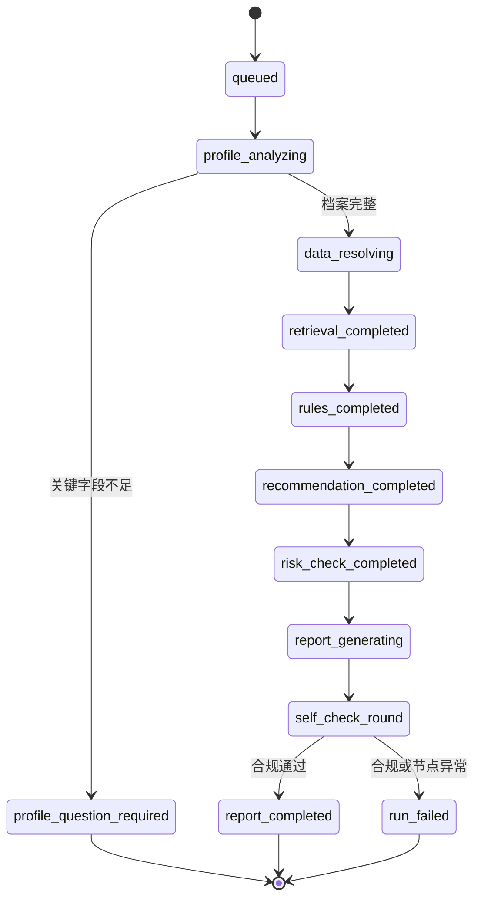

# AI Agent 工作流

## 1. 原则

“数据库和规则给结论，大模型负责理解与解释”。工作流由 Java 显式编排，每个节点可测试、可 checkpoint、可重放；不存在一个包办所有步骤的超长 Prompt。

## 2. 状态

`AdvisorRunState` 保存运行、会话、用户、档案快照、完整性、数据版本、候选、规则、硬拦截、评分、冲稳保汇总、风险、报告、证据、合规结果和当前节点。数据库中的 `state_json` 是恢复入口，`profile_snapshot_json` 是最初快照。

## 3. 实际节点顺序

1. **Profile Analyzer**：读取创建任务时的档案快照，检查省份、年份、分数/位次、科类和批次；缺字段时写入一条结构化追问消息。
2. **Data Resolver**：锁定 active dataset，检查覆盖；只有分数时查询 `rank_segments`，不能换算则只写数据警告。
3. **Retrieval**：从 `admission_records` 检索同省、同年、兼容科类和批次的学校/专业事实；控制线与特殊路径不进入普通推荐。
4. **Policy Rules**：逐候选执行省份、年份、数据范围、选科、预算、民办/合作、体检等硬规则；失败项进入 blocked 集合。
5. **Recommendation**：用数据库阈值决定层级，再计算专业、城市、学校、预算和数据质量偏好分。
6. **Risk**：检查候选集为空、保底不足、冲刺过多、位次/计划缺失、学校集中等整表问题。
7. **Report**：先产生结构化 JSON，包含三种策略、规则、风险、证据、核验清单和免责声明；模型异常时使用模板解释。
8. **Compliance**：检查过度承诺、完整免责声明和内部配置泄露；失败不会重新查询招生数据。

## 4. 事件与恢复

运行会发布 `run_started`、`profile_analyzing`、`profile_question_required`、`data_resolving`、`agents_parallel_started`、`retrieval_completed`、`rules_completed`、`recommendation_started/completed`、`risk_check_started/completed`、`report_generating`、`self_check_round`、`degraded_notice`、`report_completed`、`run_failed` 和 `heartbeat`。

每次节点变更先写 checkpoint，再发送事件。事件同时写数据库和 Redis 事件流。重连读取数据库事件，worker 重启读取未完成任务的快照；已保存的推荐/报告不会重复插入。

## 5. 局部调整现状

用户继续发送偏好变更时，系统创建新的档案版本和新运行，保留历史来源与数据版本。当前实现会重新执行确定性节点；它通过稳定业务键、数据库查询和已导入证据减少额外成本，但尚未实现节点级依赖图缓存，因此“只重跑地域评分”仍列为后续优化。

