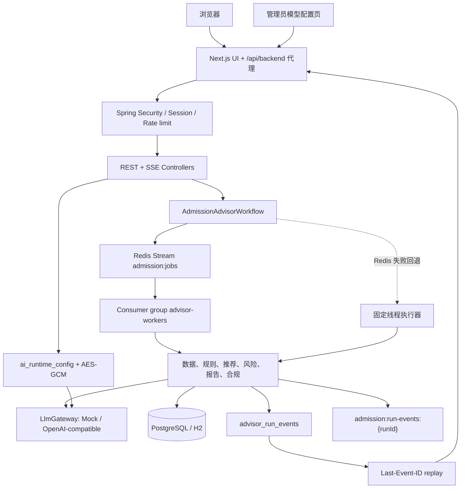

# 系统架构

## 1. 总体结构

## 2. 关键边界

- 结构化事实：`admission_records`、`rank_segments` 等关系表是分数、位次、计划和选科结论的唯一事实来源。
- 文本证据：`knowledge_documents/chunks` 和来源说明只用于解释，不可单独决定录取边界。
- 模型：业务层只依赖可动态换载的 `RuntimeLlmGateway`；Mock 与 OpenAI 兼容实现可替换，管理员保存后无需重启。规则引擎不调用模型。
- 用户数据：用户、Session、档案、对话和报告与公共招生事实分表保存。
- 前端：浏览器只访问同源 `/api/backend`，由 Next 服务端转发到后端；管理员输入的 Key 只向本系统后端提交一次，后端不会把已保存原文返回客户端。

## 3. 运行模式

| 模式 | 数据库 | 队列 | 模型 | 用途 |
|---|---|---|---|---|
| 默认本地 | 文件型 H2 | 进程内执行器，Redis 镜像失败不阻断 | Mock | 零依赖开发与演示 |
| Docker | PostgreSQL + pgvector | Redis Streams consumer group | Mock 或真实模型 | 部署与基础设施联调 |
| 测试 | 内存 H2 / Testcontainers | 进程内或容器 Redis | Mock | 可重复自动化验证 |

## 4. 可靠性设计

- `advisor_runs.idempotency_key` 唯一；同一会话同时只允许一个 QUEUED/RUNNING 任务。
- `advisor_run_checkpoints` 保存节点序号和完整状态；数据版本在解析节点锁定。
- `advisor_run_events` 持久保存有序 SSE 事件；客户端可用 `Last-Event-ID` 重放。
- Docker 模式先写 `admission:jobs`，worker 成功执行后 ACK；Redis 不可用则立即本地执行。
- 服务启动扫描 QUEUED/RUNNING 任务，使用创建时档案快照恢复；保存推荐和报告均做幂等检查。
- 模型失败由 `ReportGenerator` 使用本地模板降级，不影响确定性候选和规则。

## 5. 技术取舍

后端使用 Spring MVC `SseEmitter` 而非全量 WebFlux，便于与 JDBC/Flyway 的确定性事务模型配合。数据访问核心使用 `JdbcClient`，减少为大量异构招生 JSON 建立脆弱 ORM 实体的成本；JPA 基础设施仍保留给后续领域扩展。阈值与权重来自数据库，而不是散落在 Prompt 中。
