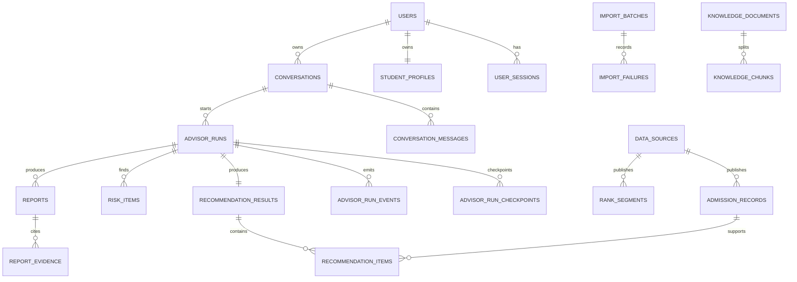

# 数据库设计

## 1. 分区原则

- 身份与隐私：`users`、`user_sessions`、`student_profiles`、`student_preferences`。
- 会话与任务：`conversations`、`conversation_messages`、`advisor_runs`、`advisor_run_checkpoints`、`advisor_run_events`。
- 公共招生事实：`universities`、`majors`、`university_majors`、`admission_records`、`rank_segments`、`admission_plans`、规则和来源表。
- 结果：`recommendation_results/items`、`risk_items`、`reports/sections/evidence`。
- 数据治理：`dataset_versions`、`data_sources`、`import_batches/failures`、`knowledge_documents/chunks`、`audit_logs`。

用户隐私表不与公共招生事实共享主键；报告通过 `user_id` 与 `run_id` 做所有权检查。对话和报告采用 `deleted_at` 软删除。

## 2. 关系概览

## 3. 约束与索引

- `admission_records.business_key` 唯一，用稳定业务字段去重；`checksum` 区分相同业务键的数据更新。
- `idx_admission_query(province, admission_year, subject_type, batch, data_type)` 支撑候选检索。
- `rank_segments` 对 `(province, admission_year, subject_type, score)` 唯一，禁止重复一分一段点。
- `province_thresholds` 对省份、年份、科类、层级唯一，层级边界不写死在代码。
- `advisor_runs.idempotency_key` 唯一；`recommendation_results.run_id` 唯一；报告对 `(run_id, version)` 唯一。
- checkpoint 对 `(run_id, sequence_no)` 唯一；SSE 事件以 `(run_id, event_id)` 为主键。
- PostgreSQL profile 通过 V100 创建 `vector` 扩展和知识块 HNSW 索引；H2 本地模式不执行该迁移。

## 4. 迁移

- `V1__core_schema.sql`：核心 29 张表、外键和索引。
- `V2__seed_thresholds.sql`：河南、广东、江西 2025 默认分层阈值与权重。
- `V3__persistent_run_events.sql`：可重放 SSE 事件。
- `V4__ai_runtime_config.sql`：管理员可动态切换的模型配置及 API Key 密文。
- `V100__pgvector.sql`：仅 PostgreSQL 的 pgvector 与 HNSW。

Flyway 在应用启动前完成迁移；Hibernate `ddl-auto=none`，不会绕过迁移修改结构。
